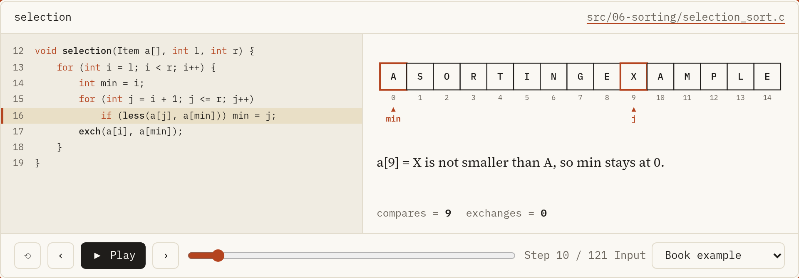

<div dir="rtl">

# Algorithms in C

[English](README.md)

كل خوارزمية ككود C حقيقي ومتجرب، وتقدر تتفرج عليه وهو شغال.



الريبو ده فيه جزئين ماشيين مع بعض:

1. **191 برنامج C99** في `src/`. ماشيين مع كتاب Robert Sedgewick بتاع *Algorithms in C* (الطبعة التالتة)، الأجزاء من 1 لـ 4، في الفصول من 1 لـ 16، ومعاهم جزء تاني عن هياكل البيانات في الفصول من 17 لـ 23 من كتب Thareja وWeiss وغيرهم. كل برنامج بيشتغل لوحده وبيطبع اللي بيحسبه. ومعظم الفصول فيها فولدر `exercises/` فيه تمارين محلولة من الكتب.
2. **كورس** بالعربي والإنجليزي: 47 درس و23 صفحة تمارين محلولة. كل درس بيشرح الفكرة بكلام بسيط، ويوريك البرنامج الحقيقي من `src/`، ويخلّيك تمشي فيه سطر سطر.

الكورس هنا: **https://mkko000.github.io/algorithms/**

## إزاي الكورس بيفضل صادق

مفيش حاجة في الموقع اتكتبت تاني بالإيد أو اترسمت بالإيد.

1. الكود اللي مكتوب إنه من الريبو بيتسحب من ملفات C باسم الدالة وقت بناء الموقع.
2. خرج البرامج بيطلع من إننا نكومبايل البرنامج ونشغّله وقت البناء.
3. التتبّع بيشغّل دالة C الحقيقية وبيسجّل المقارنات والتبديلات، فالسطر المتعلّم هو السطر الحقيقي في الملف.
4. الرسومات بتطلع من محاكاة صغيرة، والبناء بيقارن نتايجها باللي برامج C بتطبعه.

لو برنامج اتغيّر، الموقع بيتغيّر معاه، و`make check` بيفشل لو حاجة بطّلت تطابق.

## الفصول

1. [ليه الخوارزميات؟ وخريطة الكتاب](https://mkko000.github.io/algorithms/ar/intro/) (`src/01-fundamentals/`)
2. [تحليل الخوارزميات: القياس ونمو الدوال و Big-Oh](https://mkko000.github.io/algorithms/ar/analysis/) (`src/02-analysis/`)
3. [الأنواع والمصفوفات: الأساس اللي تحت كل حاجة](https://mkko000.github.io/algorithms/ar/data-structs/) (`src/03-data-structures/`)
4. [فكرة الـ ADT والـ Stack وتطبيقاته](https://mkko000.github.io/algorithms/ar/adt/) (`src/04-adt/`)
5. [الريكيرشن و Divide-and-Conquer](https://mkko000.github.io/algorithms/ar/recursion/) (`src/05-recursion-trees/`)
6. [Selection و Insertion و Bubble](https://mkko000.github.io/algorithms/ar/elem-sort/) (`src/06-sorting/`)
7. [Quicksort من الجوّه](https://mkko000.github.io/algorithms/ar/quicksort/) (`src/07-quicksort/`)
8. [Mergesort: الدمج والتحليل](https://mkko000.github.io/algorithms/ar/mergesort/) (`src/08-mergesort/`)
9. [الـ Heap و Heapsort](https://mkko000.github.io/algorithms/ar/heapsort/) (`src/09-heapsort/`)
10. [Radix Sort: البتات والـ MSD](https://mkko000.github.io/algorithms/ar/radix-sort/) (`src/10-radix-sort/`)
11. [Batcher وشبكات الترتيب](https://mkko000.github.io/algorithms/ar/special/) (`src/11-special-sorts/`)
12. [الـ Symbol Table و Key-indexed و Binary search](https://mkko000.github.io/algorithms/ar/symbol-tables/) (`src/12-bst/`)
13. [Randomized BSTs و Splay trees](https://mkko000.github.io/algorithms/ar/balanced/) (`src/13-balanced-trees/`)
14. [دوال الـ Hash و Separate chaining](https://mkko000.github.io/algorithms/ar/hashing/) (`src/14-hashing/`)
15. [Digital search trees والـ Tries](https://mkko000.github.io/algorithms/ar/tries/) (`src/15-tries/`)
16. [البحث الخارجي: ISAM و B-trees](https://mkko000.github.io/algorithms/ar/btree/) (`src/16-external-search/`)
17. [Arrays والمصفوفات: العناوين والـ Sparse والمثلثية](https://mkko000.github.io/algorithms/ar/arrays-matrices/) (`src/17-arrays-matrices/`)
18. [قوايم Header و Circular و Doubly و Cursor وكثيرات الحدود](https://mkko000.github.io/algorithms/ar/linked-variants/) (`src/18-linked-list-variants/`)
19. [Stacks وQueues: التعبيرات والتطبيقات والـ call stack والـ deque](https://mkko000.github.io/algorithms/ar/stacks-queues-apps/) (`src/19-stacks-queues/`)
20. [الشجر الثنائي: التمثيل والـ traversals وشجر التعبير وHuffman](https://mkko000.github.io/algorithms/ar/binary-trees/) (`src/20-trees/`)
21. [BST وThreaded وAVL وRed-Black وSplay](https://mkko000.github.io/algorithms/ar/efficient-trees/) (`src/21-efficient-trees/`)
22. [الأشجار متعددة الفروع: M-way وB وB+ و2-3 وTrie](https://mkko000.github.io/algorithms/ar/multiway-trees/) (`src/22-multiway-trees/`)
23. [Heaps: binary وd-heap وleftist وbinomial وFibonacci](https://mkko000.github.io/algorithms/ar/heaps/) (`src/23-heaps/`)

وكل برنامج ليه صفحة في الموقع فيها الكود كامل واللي بيطبعه.

## بناء وتشغيل كود C

محتاج gcc وmake.

```bash
make c          # build every program into bin/
make run        # build, then run every program
make check-c    # build with -Werror, then run everything
make clean
```

أو ابني ملف واحد بإيدك:

```bash
gcc -std=c99 -Wall -O2 src/07-quicksort/quicksort.c -o quicksort && ./quicksort
```

## بناء الموقع ومعاينته

محتاج Python 3.11 أو أحدث.

```bash
make venv       # create .venv and install the one dependency
make site       # build the site into _site/
make serve      # build, then serve it at http://localhost:8000
make check      # unit tests, all C programs, a full build, link and style checks
```

## شكل الريبو

```
src/                C programs by chapter, each with an exercises/ folder
content/course.toml the course: parts, lessons, titles in both languages
content/ar/         Arabic lessons in Markdown
content/en/         English lessons in Markdown
content/ui.toml     interface text in both languages
web/                the site builder, renderer, traces, figures, styles and tests
Makefile            every command above
```

## كتابة درس

الدروس ملفات Markdown فيها كام سطر زيادة بيسحبوا الكود الحقيقي:

```
::code src="src/07-quicksort/quicksort.c" fn="partition"
::output src="src/07-quicksort/quicksort.c" lines="12"
::figure partition
::trace partition

:::tip عنوان
نص النصيحة.
:::

:::quiz
السؤال؟

1. [ ] إجابة غلط
2. [x] الإجابة الصح

> ليه هي الصح.
:::
```

وفيه كمان `:::goal` و`:::oops`، ولصفحات التمارين `:::problem` و`:::think` و`:::solution`. ولو عايز تحط كود من الكتاب، اكتبه في block عليه label: ```` ```c listing="Program 7.1" ````. ضيف الدرس في `content/course.toml`، واكتبه في `content/ar/` و`content/en/`، وشغّل `make check`. والدرس اللي لسه مالوش نسخة إنجليزي بيتكتب في `content/arabic_only.txt`.

## النشر

الموقع بيتنشر على GitHub Pages عن طريق الـ workflow اللي في `.github/workflows/pages.yml` مع كل push على `main`. في إعدادات الريبو، خلّي Pages، Source = **GitHub Actions** مرة واحدة.

## الحقوق

الكود والدروس من تأليف **[محمد السيسي](https://github.com/Mkko000)**. مبني على كتاب Robert Sedgewick، *Algorithms in C* (الطبعة التالتة)، الأجزاء من 1 لـ 4: Fundamentals وData Structures وSorting وSearching (Addison Wesley)، وفصول هياكل البيانات من كتب Reema Thareja وMark Allen Weiss وغيرهم. الكتب حقوقها لأصحابها والناشرين، والمشروع ده مش بيعيد نشر نصّها.

الخطوط: Source Serif 4 وNoto Naskh Arabic وIBM Plex Mono، برخصة SIL Open Font License (`web/assets/fonts/OFL.txt`).

</div>
