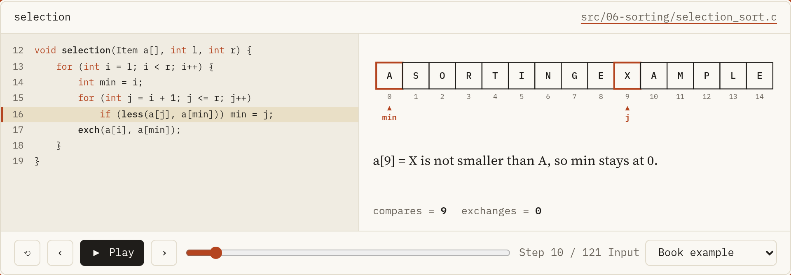

# Algorithms in C

[العربية](README.ar.md)

Every algorithm as real, tested C code you can watch run.



This repository has two parts that belong together:

1. **191 C99 programs** in `src/`. They follow Robert Sedgewick's *Algorithms in C* (3rd edition), Parts 1 to 4, in chapters 1 to 16, plus a data structures track in chapters 17 to 23 drawn from Thareja, Weiss and other books. Every program runs on its own and prints what it computes. Most chapters also have an `exercises/` folder with solved exercises from the books.
2. **A course** in Arabic and English: 47 lessons and 23 pages of solved exercises. Each lesson explains an idea in plain words, shows the real program from `src/`, and lets you step through it line by line.

Read the course at **https://mkko000.github.io/algorithms/**

## How the course stays honest

Nothing on the site is retyped or drawn by hand.

1. Code shown as coming from the repository is pulled out of the C files by function name when the site is built.
2. Program output is produced by compiling and running the program during the build.
3. Traces run the real C function with its comparisons and exchanges recorded, so the highlighted line is the real line in the file.
4. Figures are generated by small simulations, and the build checks their results against what the C programs print.

If a program changes, the site changes with it, and `make check` fails when something no longer matches.

## Chapters

1. [Why algorithms? A map of the book](https://mkko000.github.io/algorithms/en/intro/) (`src/01-fundamentals/`)
2. [Analyzing algorithms: measurement, growth and Big Oh](https://mkko000.github.io/algorithms/en/analysis/) (`src/02-analysis/`)
3. [Types and arrays: the ground everything stands on](https://mkko000.github.io/algorithms/en/data-structs/) (`src/03-data-structures/`)
4. [The idea of an ADT, the stack and what it is good for](https://mkko000.github.io/algorithms/en/adt/) (`src/04-adt/`)
5. [Recursion and divide and conquer](https://mkko000.github.io/algorithms/en/recursion/) (`src/05-recursion-trees/`)
6. [Selection, insertion and bubble sort](https://mkko000.github.io/algorithms/en/elem-sort/) (`src/06-sorting/`)
7. [Quicksort from the inside](https://mkko000.github.io/algorithms/en/quicksort/) (`src/07-quicksort/`)
8. [Mergesort: merging and its analysis](https://mkko000.github.io/algorithms/en/mergesort/) (`src/08-mergesort/`)
9. [Heaps and heapsort](https://mkko000.github.io/algorithms/en/heapsort/) (`src/09-heapsort/`)
10. [Radix sort: bits and MSD](https://mkko000.github.io/algorithms/en/radix-sort/) (`src/10-radix-sort/`)
11. [Batcher and sorting networks](https://mkko000.github.io/algorithms/en/special/) (`src/11-special-sorts/`)
12. [Symbol tables, key indexed search and binary search](https://mkko000.github.io/algorithms/en/symbol-tables/) (`src/12-bst/`)
13. [Randomized BSTs and splay trees](https://mkko000.github.io/algorithms/en/balanced/) (`src/13-balanced-trees/`)
14. [Hash functions and separate chaining](https://mkko000.github.io/algorithms/en/hashing/) (`src/14-hashing/`)
15. [Digital search trees and tries](https://mkko000.github.io/algorithms/en/tries/) (`src/15-tries/`)
16. [External searching: ISAM and B trees](https://mkko000.github.io/algorithms/en/btree/) (`src/16-external-search/`)
17. [Arrays and matrices: addresses, sparse and triangular](https://mkko000.github.io/algorithms/en/arrays-matrices/) (`src/17-arrays-matrices/`)
18. [Header, circular, doubly linked and cursor lists, and polynomials](https://mkko000.github.io/algorithms/en/linked-variants/) (`src/18-linked-list-variants/`)
19. [Stacks and queues: expressions, the call stack and the deque](https://mkko000.github.io/algorithms/en/stacks-queues-apps/) (`src/19-stacks-queues/`)
20. [Binary trees: representation, traversals, expression trees and Huffman](https://mkko000.github.io/algorithms/en/binary-trees/) (`src/20-trees/`)
21. [BST, threaded, AVL, red black and splay trees](https://mkko000.github.io/algorithms/en/efficient-trees/) (`src/21-efficient-trees/`)
22. [Multiway trees: M way, B, B+, 2-3 and tries](https://mkko000.github.io/algorithms/en/multiway-trees/) (`src/22-multiway-trees/`)
23. [Heaps: binary, d heaps, leftist, binomial and Fibonacci](https://mkko000.github.io/algorithms/en/heaps/) (`src/23-heaps/`)

Every program also has its own page on the site with its full source and output.

## Build and run the C code

You need gcc and make.

```bash
make c          # build every program into bin/
make run        # build, then run every program
make check-c    # build with -Werror, then run everything
make clean
```

Or build one file by hand:

```bash
gcc -std=c99 -Wall -O2 src/07-quicksort/quicksort.c -o quicksort && ./quicksort
```

## Build and preview the site

You need Python 3.11 or newer.

```bash
make venv       # create .venv and install the one dependency
make site       # build the site into _site/
make serve      # build, then serve it at http://localhost:8000
make check      # unit tests, all C programs, a full build, link and style checks
```

## Repository layout

```
src/                C programs by chapter, each with an exercises/ folder
content/course.toml the course: parts, lessons, titles in both languages
content/ar/         Arabic lessons in Markdown
content/en/         English lessons in Markdown
content/ui.toml     interface text in both languages
web/                the site builder, renderer, traces, figures, styles and tests
Makefile            every command above
```

## Writing a lesson

Lessons are Markdown files with a few extra lines that pull in the real code:

```
::code src="src/07-quicksort/quicksort.c" fn="partition"
::output src="src/07-quicksort/quicksort.c" lines="12"
::figure partition
::trace partition

:::tip A title
Text of the tip.
:::

:::quiz
The question?

1. [ ] a wrong answer
2. [x] the right answer

> Why it is right.
:::
```

Other blocks: `:::goal`, `:::oops`, and for exercise pages `:::problem`, `:::think` and `:::solution`. A book listing is a fenced block with a label: ```` ```c listing="Program 7.1" ````. Add the lesson to `content/course.toml`, write it in `content/ar/` and `content/en/`, and run `make check`. A lesson that has no English version yet is listed in `content/arabic_only.txt`.

## Publishing

The site is deployed to GitHub Pages by the workflow in `.github/workflows/pages.yml` on every push to `main`. In the repository settings, set Pages, Source to **GitHub Actions** once.

## Credits

Code and lessons by **Mohammed El Sisi**. Based on Robert Sedgewick, *Algorithms in C* (3rd edition), Parts 1 to 4: Fundamentals, Data Structures, Sorting, Searching (Addison Wesley), with data structure chapters drawn from Reema Thareja, Mark Allen Weiss and other textbooks. The books belong to their authors and publishers; this project does not reproduce their text.

Fonts: Source Serif 4, Noto Naskh Arabic and IBM Plex Mono, under the SIL Open Font License (`web/assets/fonts/OFL.txt`).
